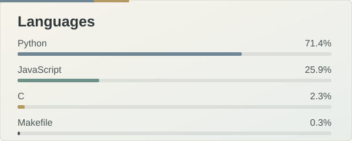
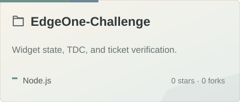
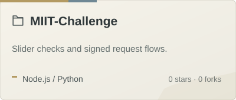
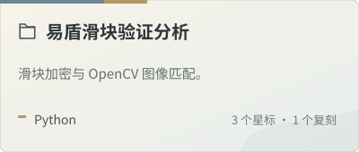
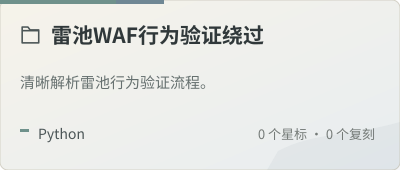

  

 

<table width="100%">
  <tr>
    <td width="36%" valign="top">
      <h2>tiny-jiu</h2>
      
<code>@tiny-jiu</code>

      
Still figuring things out, but finding a little beauty along the way.

      <h3>Interests</h3>
      

         
         
        
      

      <h3>Languages</h3>
      
        
      
       
      
    </td>
    <td width="64%" valign="top">
      <h2>Selected Projects</h2>
      
      
        
      
      
      <h3>Contribution Streak</h3>
      
        
      

        
      

    </td>
  </tr>
</table>

